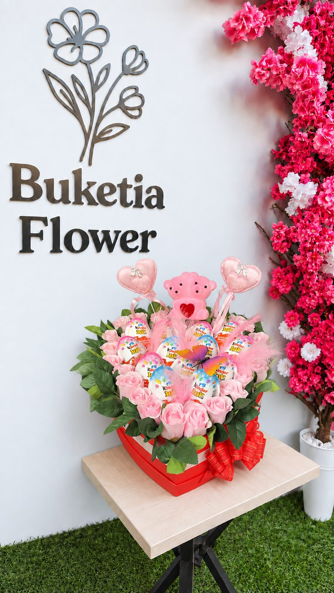
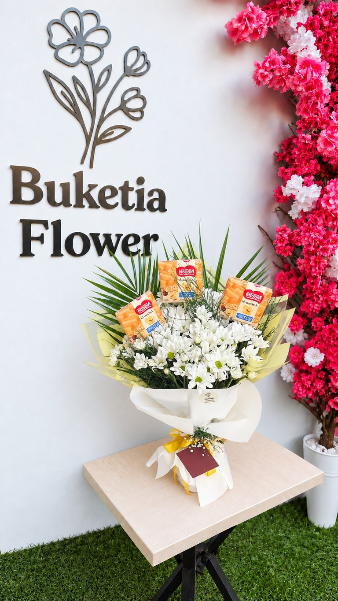
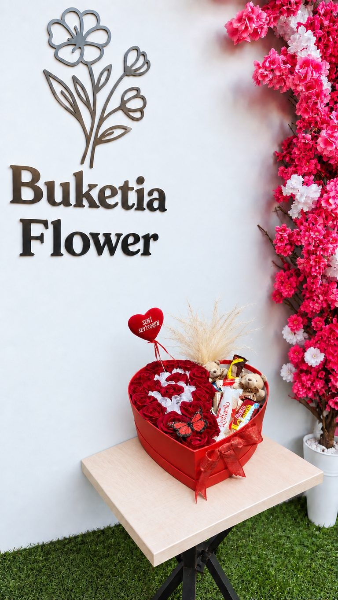
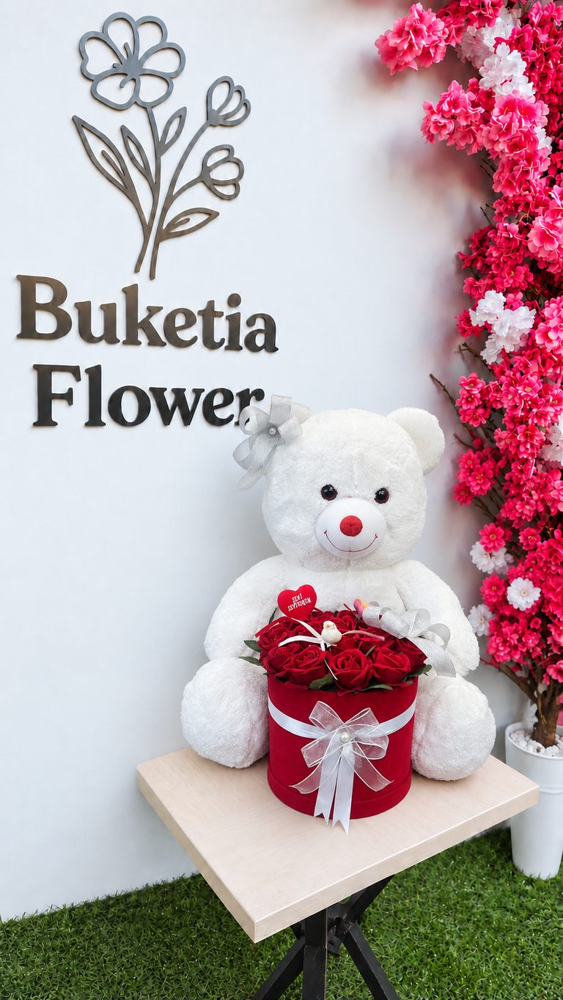
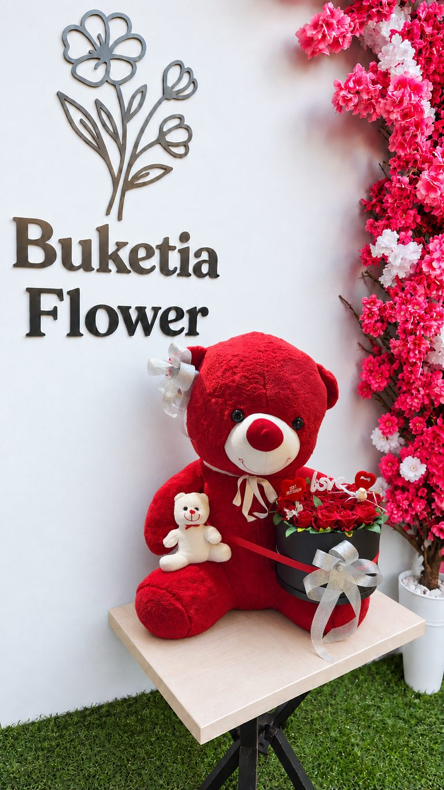
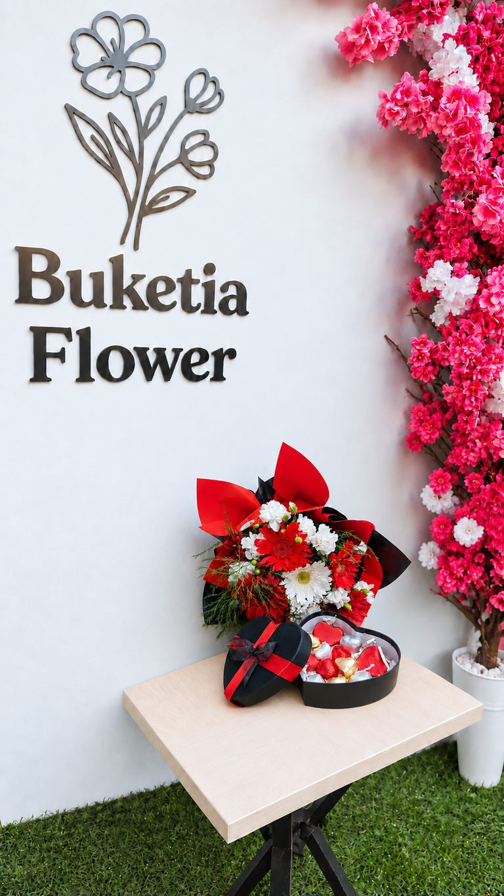
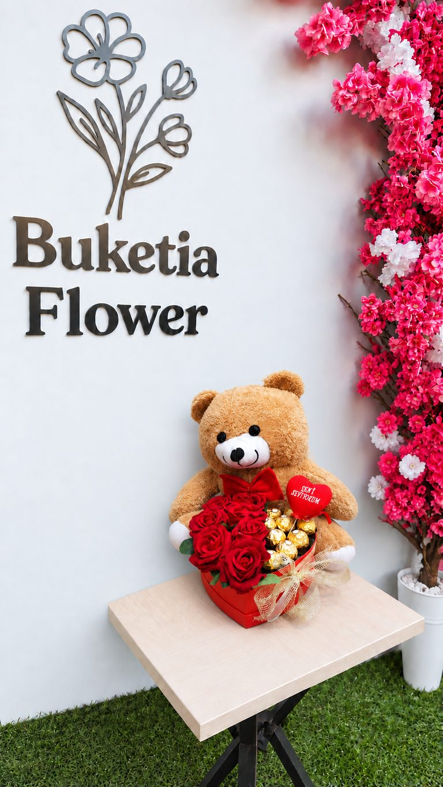

# Sevgiliye (11 görsel)

[← Tüm kategoriler](../)

Görsele dokunun, açılan sayfadaki indirme düğmesiyle telefonunuza kaydedin. Bu dosya `node build.mjs` ile üretilir; elle düzenlemeyin.

<table>
<tr><td align="center" valign="top"> <b>SVG-001</b></td><td align="center" valign="top"> <b>SVG-002</b></td><td align="center" valign="top"> <b>SVG-003</b></td></tr>
<tr><td align="center" valign="top"> <b>SVG-004</b></td><td align="center" valign="top"> <b>SVG-005</b></td><td align="center" valign="top"> <b>SVG-006</b></td></tr>
<tr><td align="center" valign="top"> <b>SVG-007</b></td><td align="center" valign="top"> <b>SVG-008</b></td><td align="center" valign="top"> <b>SVG-009</b></td></tr>
<tr><td align="center" valign="top"> <b>SVG-010</b></td><td align="center" valign="top"> <b>SVG-011</b></td></tr>
</table>
